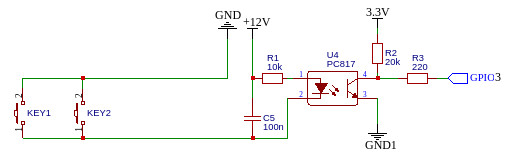
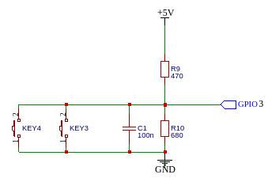

# Работа с кнопками

## Оглавление
- [Подключение кнопок к модулю](#подключение-кнопок-к-модулю)
- [Объявление кнопок в скетче](#объявление-кнопок-в-скетче)
- [Смотри также](#смотри-также)


Локальные кнопки для модулей не являются обязательными, но могут быть полезны для управления реле, например, в случае, когда поломался WiFi, а включить люстру нужно вот прямо сейчас. Или для удобства, когда для включения/выключения реле не нужно включать телефон и открывать браузер.

Количество кнопок, подключаемых к модулю, зависит от количества свободных пинов, которые могут выступать к качестве входов и имеют внутреннюю подтяжку PULLUP.

### Подключение кнопок к модулю

Если предполагается, что кнопки будут располагаться на самом модуле, можно обойтись простым подключением
```
GND <- btn -> GPIO4
```
Но, если необходимо вынести кнопки на расстояние (например, организовать несколько точек с кнопками в разных местах комнаты), то для обеспечения помехоустойчивости, лучше подключить одним из нижеследующих способов:

- вариант с гальванической развязкой



GND и GND1 между собой соединяться не должны.

- вариант без гальванической развязки



В обоих случаях можно использовать несколько кнопок, соединенных параллельно - нажатие на любую из них будет равнозначно. В качестве проводов лучше использовать витую пару, вынутую из кабеля UTP.

### Объявление кнопок в скетче

Отдельно объявлять кнопки не требуется, достаточно указать номер пина, к которому подключена кнопка, в методе `addRelay()`. О методах библиотеки для работы с кнопками [см. здесь](api.md#работа-с-кнопками)

<hr>

### Смотри также

- [Главная страница](../readme.md)
- [Web-интерфейс](web.md)
- [API библиотеки](api.md)

