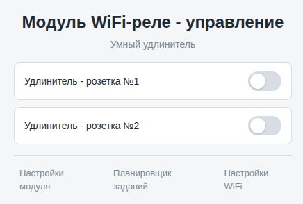
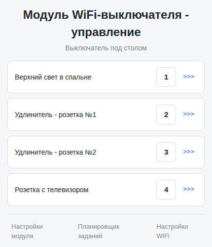
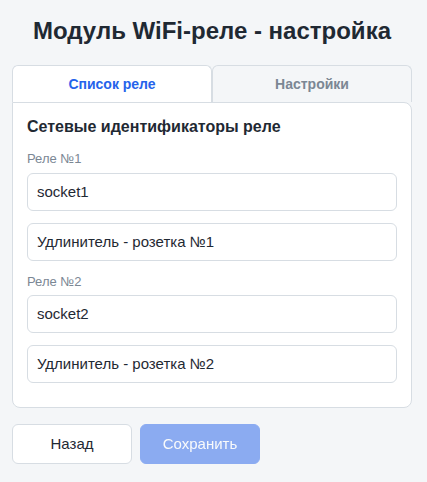
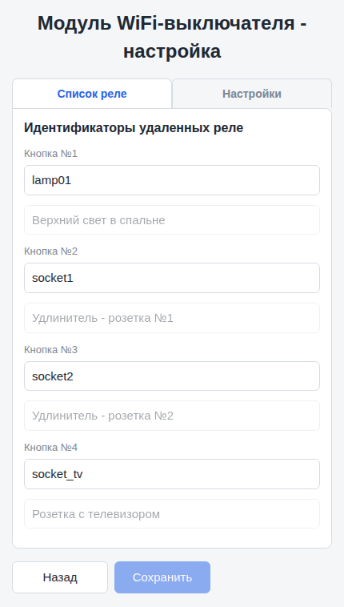
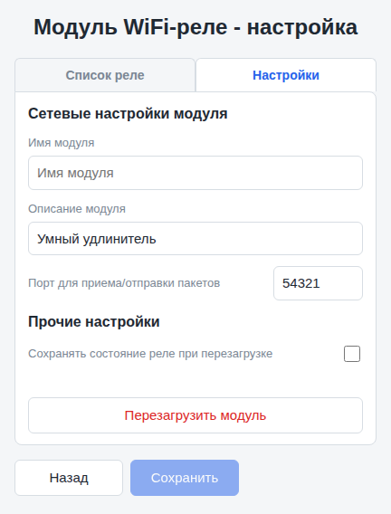
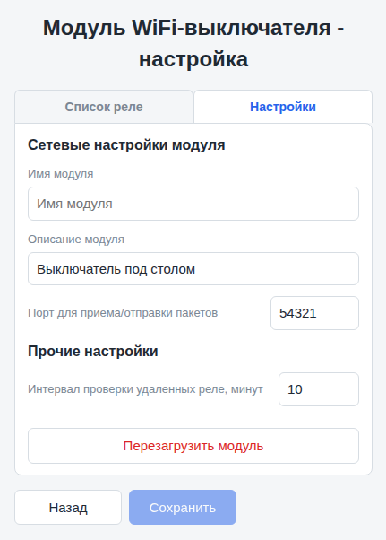
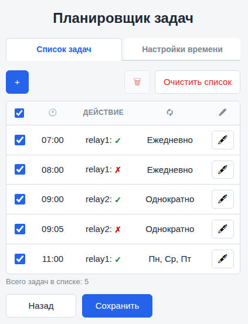
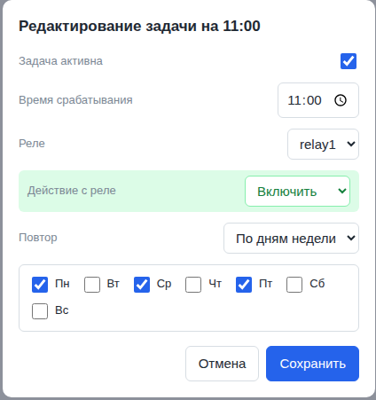
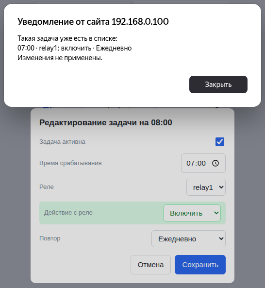
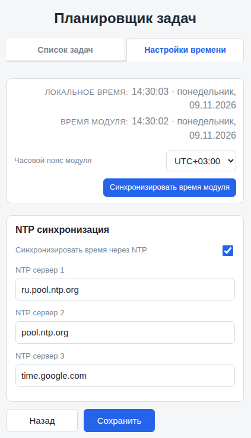

# WEB-интерфейс модулей

## Оглавление

- [Описание](#описание)
- [Главная страница модуля](#главная-страница-модуля)
- [Страница настройки модуля](#страница-настройки-модуля)
  - [Список реле](#список-реле)
  - [Настройки](#настройки)
- [Планировщик задач](#планировщик-задач)
  - [Список задач](#список-задач)
  - [Настройки времени](#настройки-времени)
- [Смотри также](#смотри-также)

### Описание

Web-интерфейс позволяет как управлять привязанными к модулю реле, так и настраивать свойства реле и параметры самого модуля, планировщика задач и (если задано) настройками WiFi- соединения. Доступ к Web-интерфейсу модуля осуществляется по адресу `http://your_ip`, где `your_ip` - IP-адрес модуля.

***Важно!!!** Web-интерфейс работает без аутентификации, т.е. в пределах локальной сети к нему имеет доступ любой пользователь; имейте это в виду*

### Главная страница модуля

 На этой странице отображаются:

- описание модуля;
- для модуля реле - переключатели и описание для каждого реле. Переключатели отображают текущее состояние реле и позволяют менять его кликом мыши.

- для модуля выключателя - кнопки и описания удаленных реле, привязанных к кнопкам; кнопки позволяют отправлять команду на переключение состояния удаленных реле кликом мыши; кроме того возле каждой кнопки отображаются кнопки-ссылки для перехода на страницу модуля удаленного реле, привязанного к этой кнопке выключателя;

- внизу страницы отображается ссылка на страницу настройки модуля;
- рядом с ней может отображаться ссылка на страницу настройки планировщика задач и параметров времени модуля; так же там может отображаться ссылка для настройки параметров WiFi; например, если вы используете библиотеку [shWiFiConfig](https://github.com/VAleSh-Soft/shWiFiConfig).

***Примечание:** о добавление ссылок на планировщик задач и настройки WiFi можно прочитать в описании метода [`attachWebInterface()`](api.md#инициализация-и-запуск-модуля)*

### Страница настройки модуля

Доступ к Web-интерфейсу настройки модуля по умолчанию осуществляется по адресу `/relay_config` как для модуля реле, так и для модуля выключателя. Страница разделена на две вкладки - **Список реле** и **Настройки**. Здесь можно настраивать следующие параметры:

#### Список реле

Здесь настраиваются параметры для каждого реле/выключателя модуля:

- **Имя реле** - сетевой идентификатор, по которому к реле будет обращаться выключатель;
- **Описание реле** - текстовое описание, которое видно только в Web-интерфейсе, для удобства настройки; для модуля выключателей это поле только для чтения;

***Важно!!!** если задать пустое имя в модуле WiFi-реле, то это реле перестанет видеться в сети, и управлять им с помощью WiFi-выключателя не получится; хотя локальной кнопкой, привязанной к этому реле, управлять им будет возможно, так же можно будет управлять им с помощью Web-интерфейса; а вот пустое имя в модуле WiFi-выключателя отключает и локальную кнопку и соответствующую кнопку в Web-интерфейсе*

Количество пар **Имя+Описание** на странице зависит от количества реле/выключателей, подключенных к модулю и заданного в прошивке методом `init()`.

***Примечание**: для модуля выключателя при вводе сетевого идентификатора реле в поле **Имя реле** выдаются подсказки в виде списка всех доступных для этого модуля выключателя удаленных реле. Список содержит все (но не более 10 штук) доступные модулю реле, которые хоть раз ответили на его broadcast-запрос после того, как он был включен.*

#### Настройки

Здесь настраиваются общие параметры модуля:

- **Имя модуля** - сетевой идентификатор модуля; пока нигде не используется, но может понадобиться в будущем;
- **Описание модуля** - общее описание, например "Выключатель возле рабочего стола"; пока отображается только на главной странице модуля;
- **Порт для приема/отправки пакетов** - номер порта, по которому идет обмен UDP-пакетами между модулями;
- **Сохранять состояние реле при перезагрузке** - опция доступна только для модуля реле, позволяет восстанавливать последнее состояние каждого реле модуля после включения питания, например, после отключения электроэнергии в доме;
- **Интервал проверки удаленных реле, минут** - опция доступна только для модуля выключателя, позволяет настраивать временной интервал между отправками широковещательных пакетов для поиска модулей реле, привязанных к выключателю;

Настройки сохраняются в файловой системе модуля в файлах **relay.json** и **switch.json** соответственно.

### Планировщик задач

Планировщик задач позволяет управлять привязанными к модулю реле по расписанию.

#### Список задач

Здесь располагаются все задачи, которые созданы на этом модуле. Каждая задача имеет поля 
- Активность - активна задача или отключена; изменить это поле можно непосредственно в списке, поставив или сняв галочку в соответствующем сек-боксе; 
- Времени срабатывания - собственно, время срабатывания задачи; 
- Действие - здесь показываются имя реле и действие, которое будет выполнено с этим реле при срабатывании задачи;
- Повтор - периодичность, с которой будет выполняться задача; доступны варианты:
  - однократое выполнение - после выполнения задача будет отключена;
  - ежедневное выполнение - задача будет выполняться каждый день;
  - по дням недели - задача будет выполняться только в выбранные дни;
  - в последней ячейке задачи располагается кнопка редактирования, позволяющая эту задачу отредактировать;

***Примечание:** при добавлении новой и редактировании имеющейся задачи выполняется проверка на наличие дубликатов, т.е. задач с точно такими же параметрами; добавить дубликат не получится, как не получится отредактировать задачу с такими же параметрами, как у другой имеющейся*

Кнопки в верхней панели позволяют добавить новую задачу, удалить выделенную или полностью очистить список задач.

#### Настройки времени

Чтобы планировщик задач имел возможность работать, время модуля должно быть установлено по возможности как можно точнее. Для этого у нас есть страница с настройками времени.

Здесь отображается локальное время, т.е. время того устройства, с которого вы зашли на эту страницу (компьютер, телефон, планшет и т.д.) и время модуля. Время модуля можно синхронизировать с локальным временем, можно выбрать нужный часовой пояс. Можно включить или отключить синхронизацию времени через Интернет, для чего предназначен блок **NTP синхронизация**.

***Примечание:** если вы отключите NTP синхронизацию, то время модуля вам придется синхронизировать своими силами - либо вручную кнопкой **Синхронизировать время модуля** (но после отключения питания время будет сброшено), либо с помощью модуля **RTC**; о работе со временем модуля [см. здесь](api.md#работа-со-временем)*

***Примечание:** планировщик задач работает по времени модуля, поэтому будьте внимательнее при выборе часового пояса*

***Важно!!!** все изменения применяются после нажатия на кнопку Сохранить*

### Смотри также

- [Главная страница](../readme.md)
- [API](api.md)
- [Работа с кнопками](buttons.md)